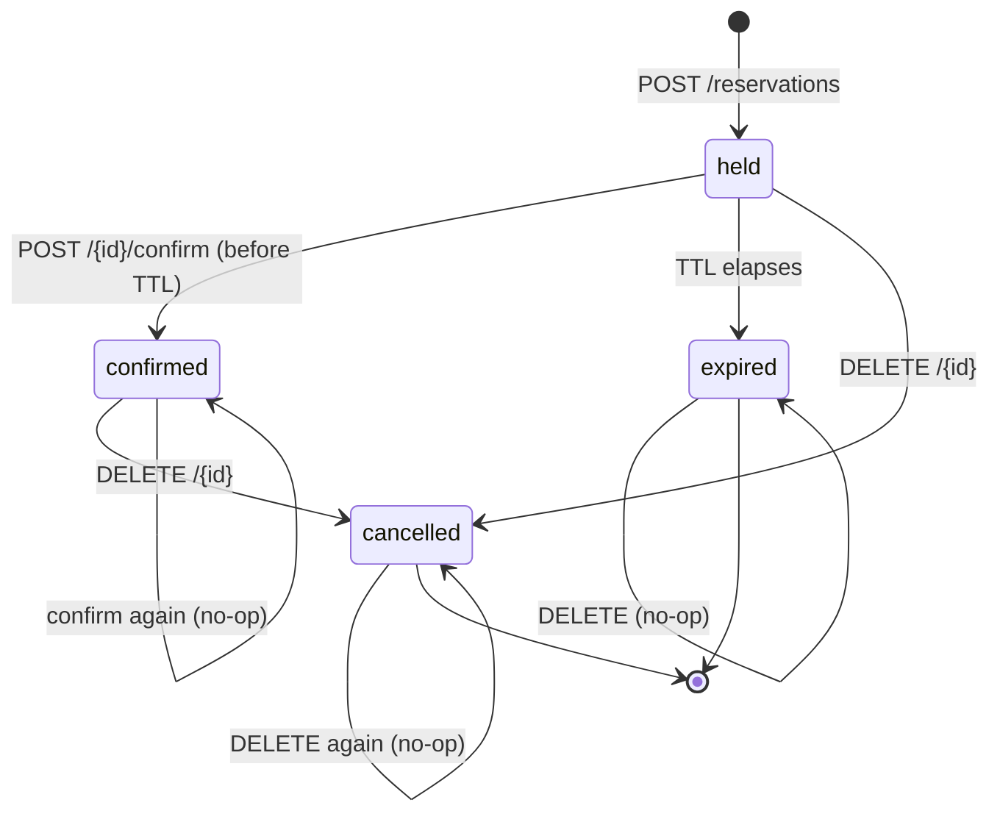
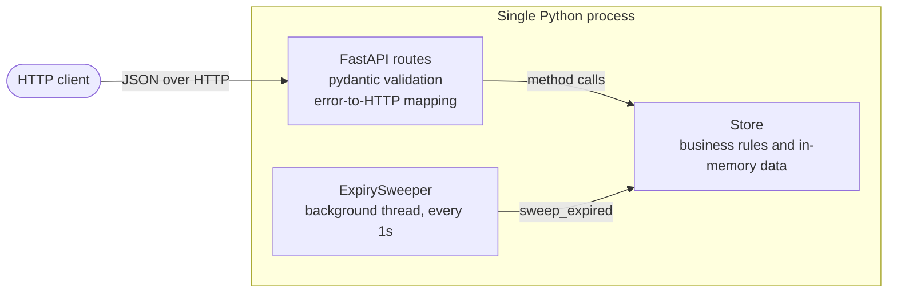

# Resource Reservation Service (prototype)

A small FastAPI service that lets clients reserve a limited shared resource,
such as a meeting room, seat, piece of equipment or charging slot, for a time
window. It guarantees four things:

- **No overbooking.** A resource never has more overlapping bookings than its
  `capacity`, even under concurrent requests.
- **Safe retries.** A client can resend a create request with the same
  `Idempotency-Key` and gets the original reservation back.
- **Abandoned holds free themselves.** A booking starts as a *hold* and
  expires after `HOLD_TTL_SECONDS` (120s) unless confirmed.
- **Idempotent cancellation.** Cancelling releases the slot, and cancelling
  twice is harmless.

It is a prototype: storage is in memory. The code is a small package,
[reservations/](reservations/), with [app.py](app.py) as the entry point:

```
app.py                  entry point: app = create_app()
reservations/
  config.py             HOLD_TTL_SECONDS, SWEEP_INTERVAL_SECONDS, clock, UTC helpers
  models.py             Resource, Reservation, ReservationStatus + overlap rules
  store.py              Store: state, locking, conflict / idempotency / expiry logic
  sweeper.py            background thread that expires stale holds
  schemas.py            pydantic request/response models
  api.py                FastAPI routes and create_app(store)

docs/                   API reference and architecture notes
```

| Document | Read it for |
|----------|-------------|
| This README | What the service is, how to run it and a one-page overview |
| [docs/API.md](docs/API.md) | The full HTTP contract: every endpoint, field, status code, header and error body |
| [docs/ARCHITECTURE.md](docs/ARCHITECTURE.md) | How it works inside: components, request flows, the state machine, locking, expiry and known limits |

## Quick start

Requires Python 3.10+.

```bash
pip install fastapi uvicorn pydantic httpx pytest
uvicorn app:app --reload        # serves http://127.0.0.1:8000
pytest -q                       # 25 tests, about 2s
```

Interactive docs (Swagger UI) are at http://127.0.0.1:8000/docs. You can
expand an endpoint, click **Try it out** and send requests from the browser.

## Core concepts

| Concept | Meaning |
|---------|---------|
| **Resource** | Something bookable. `capacity` is how many reservations may overlap at the same moment (default 1). |
| **Reservation** | A booking of one resource by one `client_id` for the half-open window `[start, end)`. A booking ending at 10:00 and one starting at 10:00 do not overlap. |
| **Hold** | Every new reservation starts as `held` and takes a slot immediately. It must be confirmed within `HOLD_TTL_SECONDS`, or it becomes `expired` and the slot is released. |
| **Idempotency key** | An optional `Idempotency-Key` request header. A repeat of the same key from the same `client_id` returns the original reservation instead of creating another. |



Only `held` (before its TTL) and `confirmed` reservations take up capacity.

## Architecture at a glance



- **API layer.** Validates input with pydantic, calls the `Store` and maps
  its `NotFound` and `Conflict` exceptions to 404 and 409.
- **Store.** Owns all state and rules: the conflict check, idempotency and
  state transitions. It is thread-safe through a lock per resource, so
  requests for different resources run in parallel. The API layer depends
  only on its public methods, so it can be swapped for a database-backed
  store.
- **ExpirySweeper.** Starts with the app and marks stale holds as `expired`.
  Expiry is also checked in real time on every request, so correctness never
  depends on the sweeper having run.

See [docs/ARCHITECTURE.md](docs/ARCHITECTURE.md) for sequence diagrams and
details.

## API summary

| Method | Path | Success | Errors |
|--------|------|---------|--------|
| `POST` | `/resources` | 201 | 422 |
| `GET` | `/resources` | 200 | — |
| `POST` | `/reservations` (optional `Idempotency-Key` header) | 201 new, 200 replay | 404, 409, 422 |
| `GET` | `/reservations?resource_id=&client_id=&status=` | 200 | 422 |
| `GET` | `/reservations/{id}` | 200 | 404 |
| `POST` | `/reservations/{id}/confirm` | 200 | 404, 409 |
| `DELETE` | `/reservations/{id}` | 200 | 404 |

The full request and response schemas, plus a worked example session, are in
[docs/API.md](docs/API.md).

## Where to change what

| To change... | Edit |
|--------------|------|
| Hold TTL or sweep interval | [reservations/config.py](reservations/config.py) |
| What counts as an overlap, or which statuses take a slot | `Reservation.overlaps` and `occupies_slot` in [reservations/models.py](reservations/models.py) |
| Conflict, capacity, idempotency or state-transition rules | `Store` in [reservations/store.py](reservations/store.py) |
| Request validation or response fields | [reservations/schemas.py](reservations/schemas.py) |
| Endpoints, status codes or headers | [reservations/api.py](reservations/api.py) |
| The storage backend | Write a class with the same public methods as `Store` and pass it to `create_app(store)` |

`create_app` can also be used directly, for example to embed the service or
to test against a pre-filled store:

```python
from reservations import Store, create_app

store = Store()
store.create_resource("Room A", "room", capacity=1)
app = create_app(store)        # serve with uvicorn, or wrap in TestClient
```

## Configuration

These are module-level constants in
[reservations/config.py](reservations/config.py) and are not read from
environment variables.

| Name | Default | Effect |
|------|---------|--------|
| `HOLD_TTL_SECONDS` | `120` | How long a hold lasts before expiring. It is read when each hold is created. |
| `SWEEP_INTERVAL_SECONDS` | `1.0` | How often the background sweeper runs. It is read at startup. |

## Tests

[test_app.py](test_app.py) uses `fastapi.testclient.TestClient`. Each test
builds its own app with `create_app(Store())`. To shorten timings, the tests
patch `reservations.config`. The suite covers:

- the hold-and-confirm happy path
- overlap rejection and touching windows
- 20 concurrent requests for one slot, where exactly one wins
- capacity N, and the peak-concurrency rule
- idempotent replay, scoping keys by client, and concurrent retries with
  one key
- cancel releasing the slot and being idempotent
- real-time expiry, confirming an expired hold (409) and the background
  sweeper, using `monkeypatch` to shrink the TTL

## Limitations of the prototype

- State is in memory. It is lost on restart and not shared between processes,
  so run a single uvicorn worker.
- `client_id` is taken from the request body without authentication.
- A reused idempotency key returns the original reservation even if the new
  request body is different.
- Lock and idempotency maps are never pruned, so memory grows with use.

## What would change for production

- **Postgres enforces the rules.** Store windows as
  `tstzrange(start, "end", '[)')`. For capacity 1, add
  `EXCLUDE USING gist (resource_id WITH =, period WITH &&) WHERE (status IN ('held','confirmed'))`.
  Capacity N can be modelled either as N unit rows with the same constraint,
  or as `SELECT ... FOR UPDATE` on the resource row followed by the
  concurrency check in one transaction. Hold expiry must be part of the
  constraint's predicate or handled by a scheduled job.
- **A real idempotency table.** Use
  `idempotency_keys(client_id, key, request_hash, reservation_id, created_at)`
  with `UNIQUE (client_id, key)`, written in the same transaction as the
  reservation. Return 422 when a key is reused with a different body, and
  expire keys after a retention window.
- **Authentication.** Derive `client_id` from a bearer token or API key
  instead of the body, and allow only owners or admins to read, confirm or
  cancel a reservation.
- **Expiry across replicas.** Use one scheduled job or a delayed queue instead
  of a thread in each process, or rely only on predicate-based expiry in
  queries.
- **Metrics and logs.** Add counters for conflicts (409s by resource), holds
  created, confirmed and expired, idempotent replays and cancellations. Add
  a hold-to-confirm latency histogram and lock-wait or transaction-retry
  metrics, and use structured logs that carry request and reservation ids.
- **API hardening.** Add pagination, limits on window length and booking
  horizon, rate limits per client, optimistic versioning or `ETag`s, and a
  consistent error envelope.
