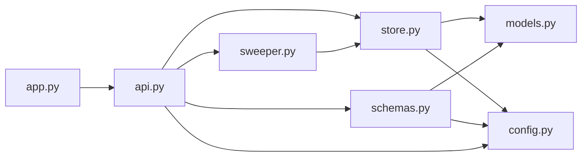
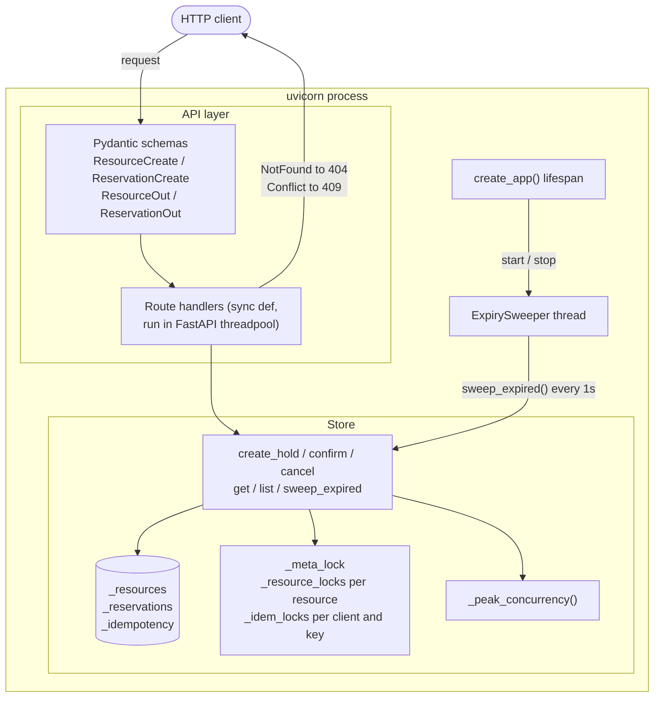
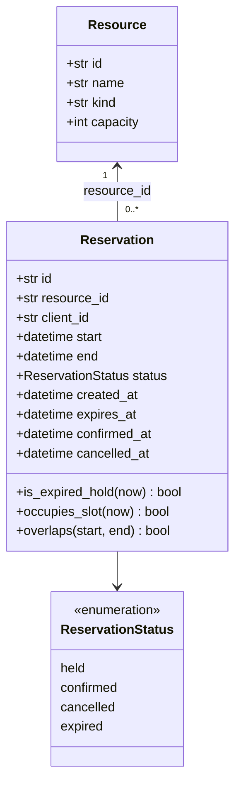
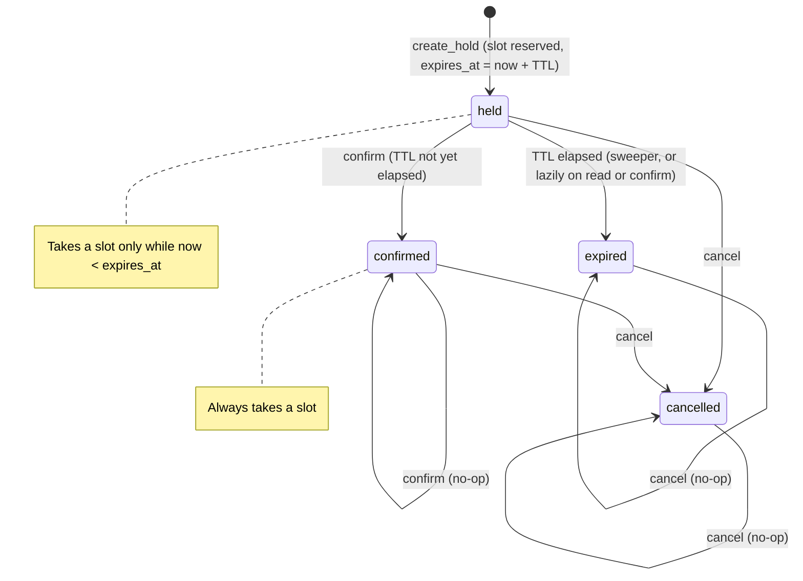
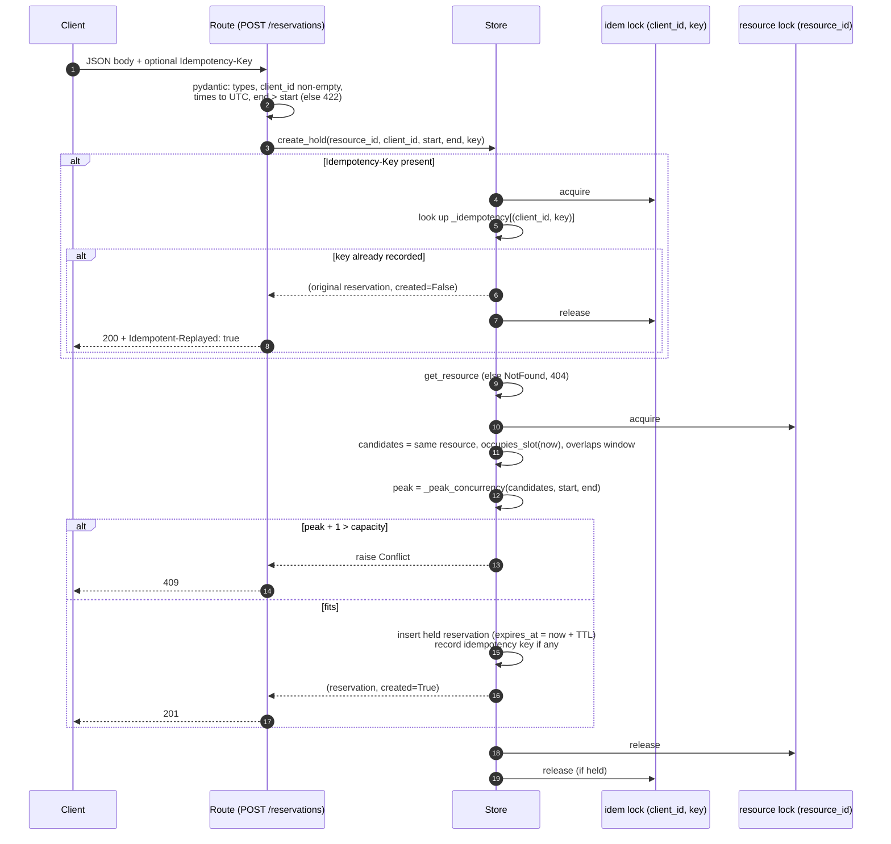
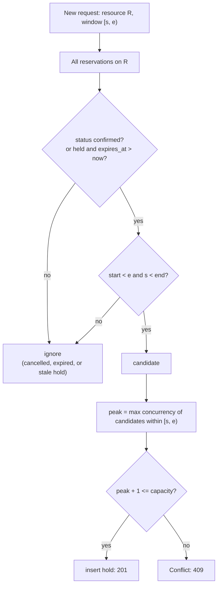
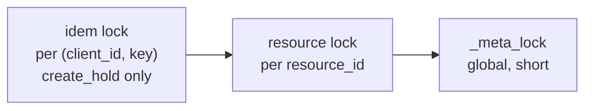
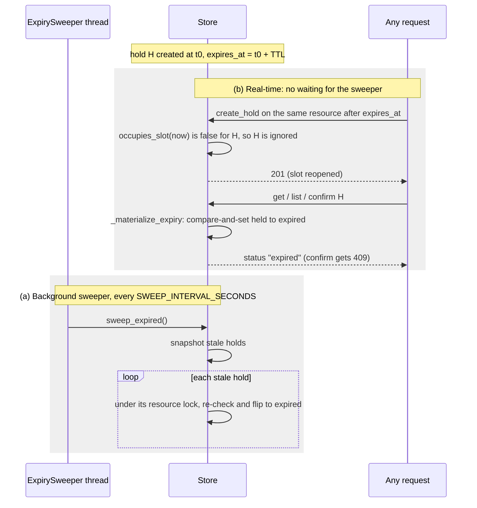
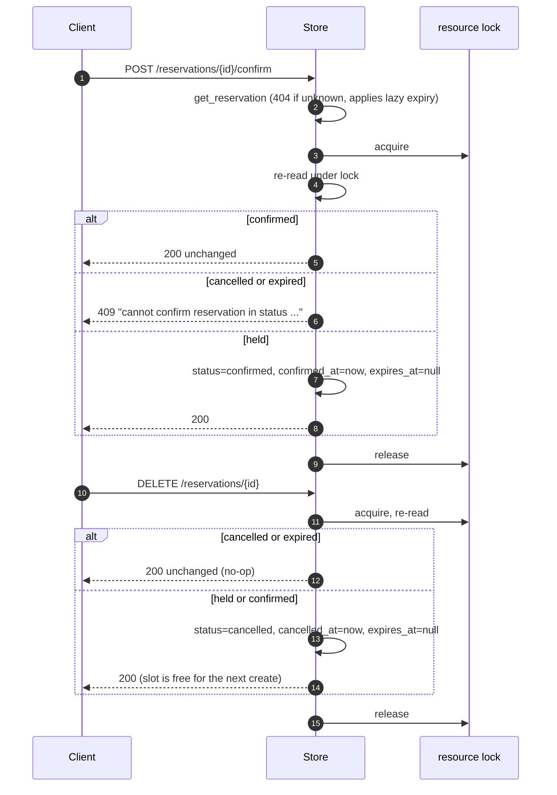

# Architecture

This document explains how the service in the
[reservations/](../reservations/) package works inside: the components, how a
request moves through them, and why the conflict, idempotency and expiry
rules hold under concurrency. For the external HTTP contract, see
[API.md](API.md).

## 1. Components

Everything runs in one Python process. [app.py](../app.py) is only the entry
point (`app = create_app()`). The code lives in these modules:

| Module | Key names | Responsibility |
|--------|-----------|----------------|
| [config.py](../reservations/config.py) | `HOLD_TTL_SECONDS`, `SWEEP_INTERVAL_SECONDS`, `utcnow()`, `to_utc()` | Tunables, plus a single clock and UTC normalisation |
| [models.py](../reservations/models.py) | `Resource`, `Reservation`, `ReservationStatus` | Immutable (frozen) dataclasses. `Reservation` decides for itself whether it overlaps a window and whether it still takes a slot. |
| [store.py](../reservations/store.py) | `Store`, `NotFound`, `Conflict`, `_peak_concurrency()` | All state, business rules and locking. Raises exceptions with no HTTP knowledge. `_peak_concurrency` is the sweep line that finds peak overlap inside a window. |
| [sweeper.py](../reservations/sweeper.py) | `ExpirySweeper` | A daemon thread that calls `Store.sweep_expired()` every `SWEEP_INTERVAL_SECONDS` |
| [schemas.py](../reservations/schemas.py) | `ResourceCreate`, `ResourceOut`, `ReservationCreate`, `ReservationOut` | Pydantic models for validation (including `end > start`) and serialisation (UTC `Z` timestamps) |
| [api.py](../reservations/api.py) | `create_app()`, `router`, `get_store` | HTTP wiring. Routes translate `NotFound` to 404 and `Conflict` to 409. `create_app(store)` attaches the `Store` to `app.state` and starts and stops the sweeper in the app's lifespan. |

Dependencies point one way: towards the domain and away from HTTP.



At runtime, a request flows through the layers like this:



**Seam for a database.** Routes call only the public `Store` methods, and
they get the store through the `get_store` dependency, which reads
`app.state.store`. A database-backed store implementing the same methods
could be passed to `create_app(store)` without changing the API layer. The
tests use the same seam: each test builds `create_app(Store())` with a fresh
store.

**Why the handlers are sync.** The handlers are plain `def`, so FastAPI runs
each request on a threadpool worker. That makes the `threading.Lock`s
meaningful, because requests really do run in parallel. It also means a
request waiting on a lock blocks a worker thread, not the event loop.

## 2. Data model

Code: [models.py](../reservations/models.py) for the records and
[store.py](../reservations/store.py) for the maps that hold them.



The store holds three maps:

| Map | Key | Value |
|-----|-----|-------|
| `_resources` | resource id | `Resource` |
| `_reservations` | reservation id | `Reservation` |
| `_idempotency` | `(client_id, idempotency_key)` | reservation id |

Records are immutable. Every state change builds a new object with
`dataclasses.replace` and swaps it into the map while holding `_meta_lock`.

## 3. Reservation lifecycle



| From \ action | confirm | cancel | TTL elapses |
|---------------|---------|--------|-------------|
| `held` | moves to `confirmed` and clears `expires_at` | moves to `cancelled` | moves to `expired` |
| `confirmed` | returns it unchanged | moves to `cancelled` | — |
| `cancelled` | **409** | returns it unchanged | — |
| `expired` | **409** | returns it unchanged | — |

## 4. Creating a reservation

Code: `create_reservation` in [api.py](../reservations/api.py), which calls
`Store.create_hold` and `Store._create_hold_locked` in
[store.py](../reservations/store.py).

### 4.1 Request flow



### 4.2 Conflict rule

A new reservation `[start, end)` is accepted only if:

```
peak_concurrency(active reservations on this resource overlapping [start, end)) + 1 <= capacity
```

- **Active** means `confirmed`, or `held` with `expires_at > now`. Holds past
  their TTL are ignored even if the sweeper has not yet flipped them, so a
  slot reopens the moment a hold expires.
- **Overlaps** uses half-open intervals: `a.start < b.end and b.start < a.end`.
  Touching windows such as `09:00–10:00` and `10:00–11:00` do not overlap.
- **Peak concurrency, not overlap count.** With capacity 2 and existing
  bookings at 9–10 and 11–12, a new 9–12 booking overlaps both but never
  coexists with more than one of them. Counting overlaps would wrongly reject
  it. `_peak_concurrency` clips each candidate to the requested window, emits
  `+1` at each start and `-1` at each end, and sorts so that `-1` comes
  before `+1` at the same instant, which matches half-open semantics. It
  returns the highest running total.



### 4.3 Idempotency rule

- Keys are scoped by `(client_id, Idempotency-Key)`, so two clients that pick
  the same key never collide.
- Each scope has its own lock, so concurrent retries carrying the same key
  are serialised. The first creates the reservation, and the rest replay it.
  This is covered by `test_concurrent_retries_with_same_key_create_once`.
- A key is recorded only when a reservation is successfully created, inside
  the same critical section as the insert. A request that fails with 404 or
  409 leaves no record, so retrying the same key later is evaluated afresh.
- A replay returns the reservation in its **current** state. For example, it
  may be `confirmed` or `cancelled` by then. The request body of a replay is
  **not** compared with the original.

## 5. Concurrency model

All locking lives in `Store` in [store.py](../reservations/store.py). There
are three kinds of lock, always acquired in the same order, so they cannot
deadlock:



| Lock | Protects | Held during |
|------|----------|-------------|
| `_idem_locks[(client_id, key)]` | The lookup-or-create sequence for one idempotency key | The whole `create_hold` call when a key is sent |
| `_resource_locks[resource_id]` | The check-then-insert or check-then-transition sequence for one resource | Conflict check and insert; confirm; cancel; each sweep flip |
| `_meta_lock` | The dicts themselves and lazy creation of the locks above | Individual dict reads and writes only |

Consequences:

- Two requests for the **same** resource are serialised through the
  availability check, so they cannot both win the last slot. This is
  covered by `test_concurrent_requests_only_one_wins`, which sends 20
  parallel requests and expects one 201 and nineteen 409s.
- Requests for **different** resources never wait on each other, apart from
  very short `_meta_lock` sections.
- `confirm` and `cancel` take the resource lock and then re-read the
  reservation, so a confirm racing a cancel, or a confirm racing expiry,
  produces a single consistent outcome.

## 6. Expiry

Expiry is implemented in two independent ways. The real-time check is the
one that guarantees correctness. The sweeper only tidies up stored state.

Code: `Reservation.occupies_slot` in [models.py](../reservations/models.py),
`Store._materialize_expiry` and `Store.sweep_expired` in
[store.py](../reservations/store.py), and `ExpirySweeper` in
[sweeper.py](../reservations/sweeper.py).



- **Lazy materialisation.** `get_reservation` and `list_reservations` flip a
  stale hold to `expired` before returning it, so a status filter like
  `?status=held` never includes an expired hold. The flip is a
  compare-and-set: it writes only if the stored record is still a stale
  hold, so it never overwrites a confirm or cancel that happened first.
- **Sweeper lifecycle.** The lifespan built by `create_app()` starts an
  `ExpirySweeper` for that app's store on startup and stops it on shutdown.
  It does not run under a `TestClient` that isn't used as a context manager.
  That is why most expiry tests prove that real-time expiry works on its
  own, while `test_sweeper_marks_expired_holds` uses
  `with TestClient(create_app(store))` to exercise the thread.
- **TTL lookup.** The store reads `config.HOLD_TTL_SECONDS` when each hold is
  created, through the module attribute rather than a copy made at import.
  Tests can therefore shrink it with
  `monkeypatch.setattr(config, "HOLD_TTL_SECONDS", ...)`. `create_app()`
  reads `SWEEP_INTERVAL_SECONDS` the same way when the app starts.

## 7. Cancellation and confirmation flows



## 8. Time handling

- All stored times are timezone-aware UTC. Request times are normalised by
  `to_utc` in [config.py](../reservations/config.py), which the
  `ReservationCreate` validator calls: offsets are converted, and naive
  values are taken as UTC.
- `config.utcnow()` is the only clock, which makes it a single point to
  freeze time in future tests.
- Responses serialise as ISO-8601 with a `Z` suffix, for example
  `2030-01-01T09:00:00Z`. Conflict error messages print times with
  `+00:00`, because they use Python's `isoformat()`.

## 9. Known limits

These are deliberate prototype limits. The production plan is in the
[README](../README.md#what-would-change-for-production).

| Limit | Impact |
|-------|--------|
| In-memory `Store` | Data is lost on restart. Multiple uvicorn workers would each have their own data and locks, so run exactly **one** worker. |
| A conflict check scans all reservations | Cost is O(total reservations) per create. That is fine for a prototype, but an index by resource is needed at scale. |
| Lock and idempotency maps are never pruned | Memory grows with the number of resources and keys. |
| Replay does not compare request bodies | Reusing a key for a different booking silently returns the original. |
| `client_id` comes from the body | Anyone can act as any client. |
| No ownership checks | Anyone who knows a reservation id can confirm or cancel it. |
